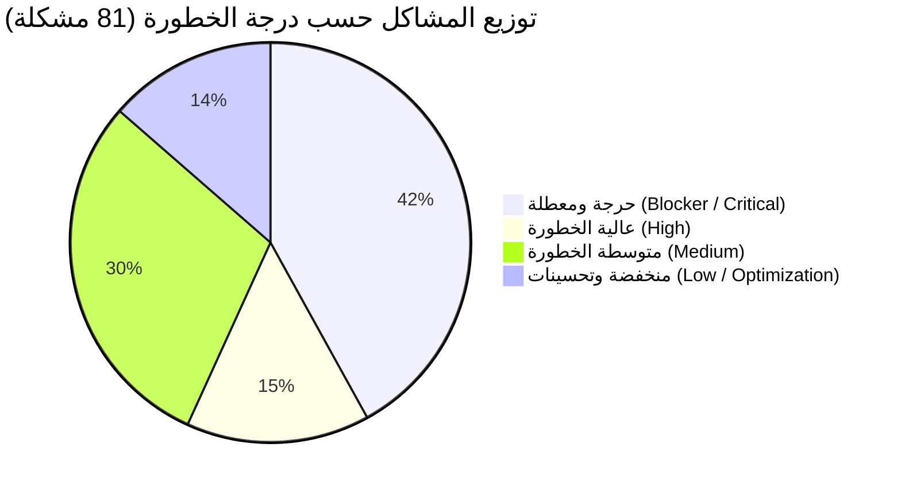
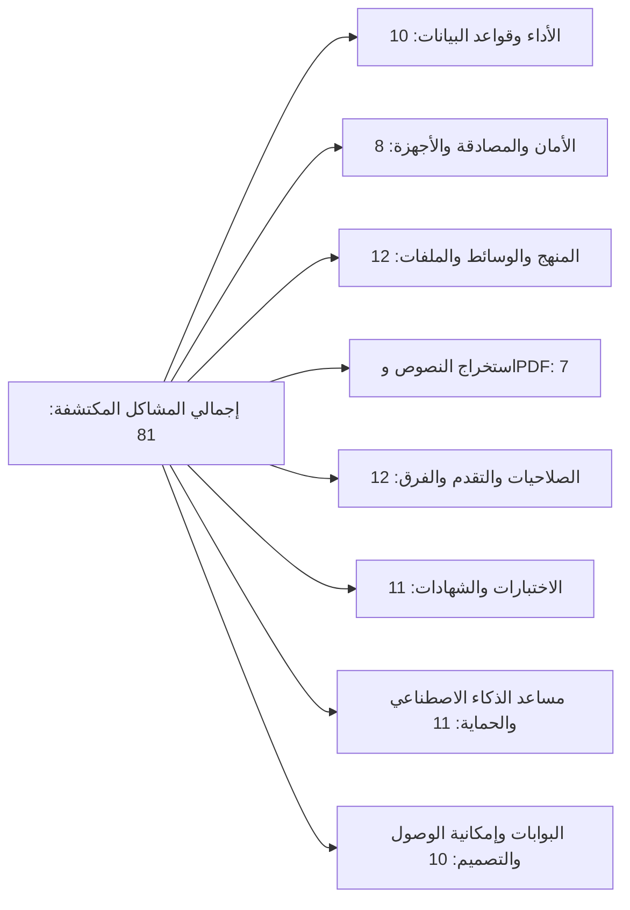
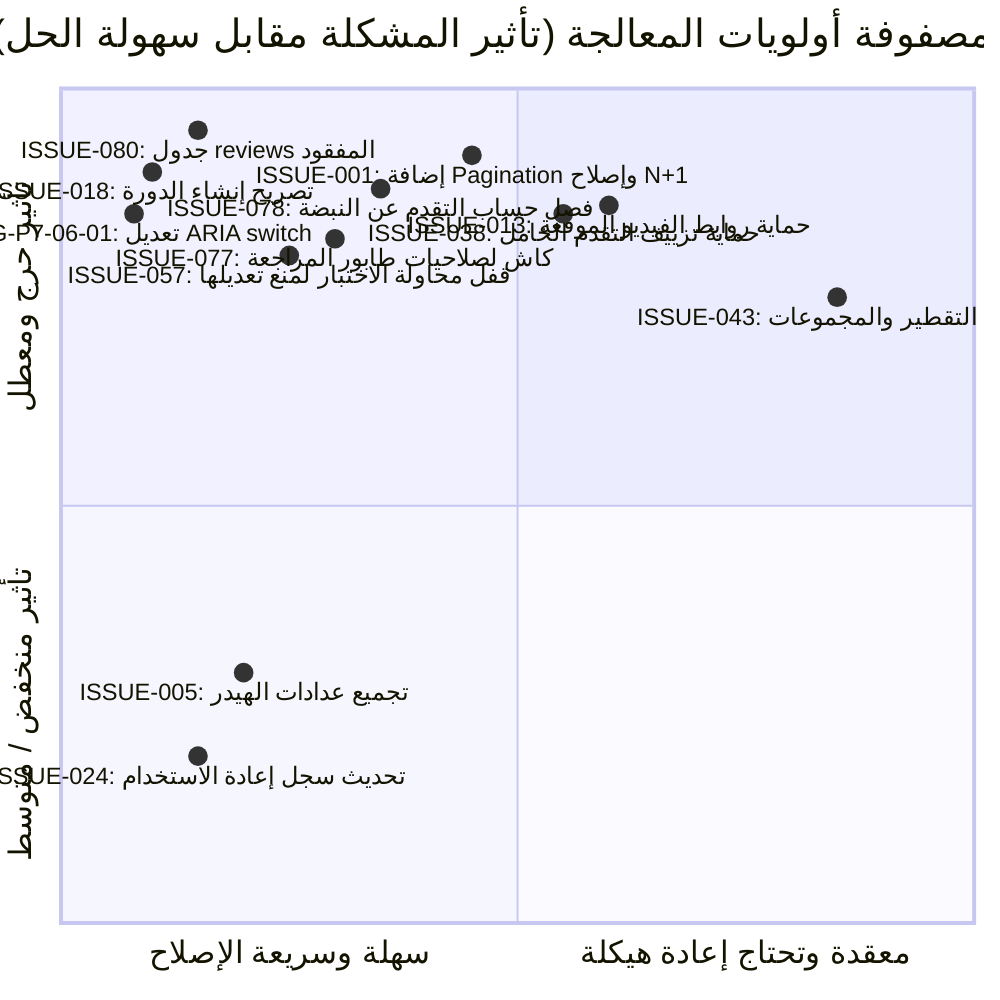

# التقرير الموحد الشامل لكافة المشاكل والعيوب البرمجية (Young Go LMS Unified Audit Report)

**المشروع:** Young Go LMS  
**تاريخ التدقيق:** 18 نوفمبر 2026  
**نطاق التدقيق:** تدقيق استكشفي شامل (Discovery-only Audit) لكافة طبقات النظام (الأداء، الأمان، سلامة البيانات، دورات التعلم، الاختبارات، الذكاء الاصطناعي، والامتثال للتصميم).  
**إجمالي المشاكل الموثقة:** **81 مشكلة** (`ISSUE-001` إلى `ISSUE-080` بالإضافة إلى `BUG-P7-06-01`).

---

## 1. الملخص التنفيذي وتوزيع المشاكل (Executive Summary & Distribution)

تم توحيد نتائج كافة جولات المراجعة السابقة والقياسات المعيارية المباشرة عبر **Laravel Telescope** (`http://127.0.0.1:8080/telescope`) و **Playwright Chromium** في هذا التقرير الشامل. لم يتم تعديل أي كود أو إعدادات أثناء استخراج هذه النتائج.

---

## 2. مشاكل الأداء وقواعد البيانات والانهيارات الفورية (Performance & Runtime Blockers)

تم تأكيد هذه المشاكل وقياسها معملياً عبر طلبات فعلية مسجلة في **Laravel Telescope** بالـ UUID والزمن:

### [ISSUE-080] انهيار صفحة تفاصيل الدورة العامة GET /courses/{slug} بخطأ 500
- **الأولوية:** حرج ومعطل للخدمة (Critical Blocker)
- **المسار:** `GET /courses/{slug}` (مثال: `GET /courses/demo-course`)
- **الدور:** زائر عام / طالب (`guest`, `student`)
- **القياس والأدلة:** استجابة **500 Server Error** وتوقف استمر **13,569 ms**! سجل Telescope خطأ `QueryException: no such table: course_reviews`.
- **السبب الجذري:** يستدعي كود الـ SEO الدالة `ReviewSummary::for($course)` في السطر 28 من `CourseSeo.php`، والتي تستعلم عن جدول `course_reviews` غير المنشأ إطلاقاً في قاعدة البيانات.
- **الملف والسطر:** [`app/Domain/Engagement/ReviewSummary.php:21`](file:///c:/projects/young-go-lms-pack-v3.2/young-go-lms-pack-v3.2/app/Domain/Engagement/ReviewSummary.php#L21) و [`app/Domain/Course/Seo/CourseSeo.php:28`](file:///c:/projects/young-go-lms-pack-v3.2/young-go-lms-pack-v3.2/app/Domain/Course/Seo/CourseSeo.php#L28) و [`app/Http/Controllers/PublicCourseController.php:30`](file:///c:/projects/young-go-lms-pack-v3.2/young-go-lms-pack-v3.2/app/Http/Controllers/PublicCourseController.php#L30).
- **معرف Telescope:** `a3401454-cbba-4125-ad79-cb963d84f9af`

---

### [ISSUE-001] انفجار استعلامات N+1 وغياب التصفح (Pagination) في صفحات الطالب وولي الأمر
- **الأولوية:** حرج (Critical)
- **المسارات المتأثرة:** `GET /my` (لوحة الطالب)، `GET /my/courses` (دورات الطالب)، و `GET /parent` (لوحة ولي الأمر).
- **الدور:** طالب (`student`)، ولي أمر (`parent`)
- **القياس والأدلة:**
  - في `/my`: قفزت الاستعلامات من 134 إلى **1,206 استعلامات** (2,042.6 ms) عند الانتقال من 5 إلى 50 دورة.
  - في `/my/courses`: قفزت من 114 إلى **1,104 استعلامات** (2,111.4 ms) مع عرض 50 دورة دفعة واحدة دون تصفح.
  - في `/parent`: تنفيذ **51 استعلاماً** لدورة واحدة فقط لابن مسجل.
- **السبب الجذري:** حلقة `foreach` في `LearnerCourseRows::for` تستدعي `RecalculateCourseProgress` و `ContinueLearning` لكل دورة على حدة بدلاً من الجلب المجمع (Eager Loading).
- **الملف والسطر:** [`app/Domain/Progress/Queries/LearnerCourseRows.php:22-38`](file:///c:/projects/young-go-lms-pack-v3.2/young-go-lms-pack-v3.2/app/Domain/Progress/Queries/LearnerCourseRows.php#L22-L38) و [`app/Http/Controllers/LearnerHomeController.php:49-62`](file:///c:/projects/young-go-lms-pack-v3.2/young-go-lms-pack-v3.2/app/Http/Controllers/LearnerHomeController.php#L49-L62) و [`app/Http/Controllers/ParentDashboardController.php:40`](file:///c:/projects/young-go-lms-pack-v3.2/young-go-lms-pack-v3.2/app/Http/Controllers/ParentDashboardController.php#L40).
- **معرفات Telescope:** `a33ffe20-a147-4556-8246-24f8dfae411f` و `a3401406-3495-4da1-8efa-948e8228ee25`

---

### [ISSUE-077] تكرار فحص الصلاحيات غير المخزن مؤقتاً في طوابير مراجعة المدرس إلى 513 استعلاماً
- **الأولوية:** عالية (High)
- **المسار:** `GET /instructor/submission-review` و `GET /instructor/essay-review`
- **الدور:** مدرس (`instructor`)
- **القياس والأدلة:** قفزت الاستعلامات من 63 إلى **513 استعلاماً** وتأخر الطلب إلى **2,725 ms** عند زيادة دورات المدرس من 5 إلى 50.
- **السبب الجذري:** استدعاء الدالة `ReviewAccess::courseIds` خمس مرات في الطلب الواحد، مع فحص `Gate::allows('update', $course)` لكل دورة في قاعدة البيانات دون تخزين مؤقت (Request Memoization).
- **الملف والسطر:** [`app/Domain/Assessment/Queries/ReviewAccess.php:38-41`](file:///c:/projects/young-go-lms-pack-v3.2/young-go-lms-pack-v3.2/app/Domain/Assessment/Queries/ReviewAccess.php#L38-L41) و [`app/Filament/Resources/Courses/Pages/SubmissionReviewResource.php:74`](file:///c:/projects/young-go-lms-pack-v3.2/young-go-lms-pack-v3.2/app/Filament/Resources/Courses/Pages/SubmissionReviewResource.php#L74).
- **معرف Telescope:** `a34000ed-9220-473e-b69e-422a527b23d1`

---

### [ISSUE-078] إعادة احتساب تقدم الدورة تزامناً مع كل نبضة مشغل فيديو (Heartbeat Contention)
- **الأولوية:** عالية (High)
- **المسار:** `POST /learn/{course}/{item}/progress`
- **الدور:** طالب (`student`)
- **القياس والأدلة:** كل نبضة ترسل كل 10-15 ثانية تنفذ **25 استعلاماً وعمليتي كتابة UPDATE متزامنتين** في `course_progress`!
- **السبب الجذري:** يستدعي `RecordProgress::heartbeat` الدالة `RecalculateCourseProgress::forLearner` تزامناً في كل نبضة، مما يستعلم عن كامل منهج وأقسام الدورة ويقفل الصف في قاعدة البيانات، مما يهدد بتوقف الخادم عند تزامن مئات الطلاب.
- **الملف والسطر:** [`app/Domain/Progress/Actions/RecordProgress.php:34-45`](file:///c:/projects/young-go-lms-pack-v3.2/young-go-lms-pack-v3.2/app/Domain/Progress/Actions/RecordProgress.php#L34-L45) و [`app/Http/Controllers/ProgressController.php:31`](file:///c:/projects/young-go-lms-pack-v3.2/young-go-lms-pack-v3.2/app/Http/Controllers/ProgressController.php#L31).
- **معرف Telescope:** `a33ffe23-07c2-4f63-a2da-a92b3671cb88`

---

### [ISSUE-018] منع المدرس من بدء إنشاء دورة تدريبية (403 Forbidden)
- **الأولوية:** حرج ومعطل لرحلة المدرس (Critical Blocker)
- **المسار:** `GET /instructor/courses/create`
- **الدور:** مدرس أكاديمي ومستقل (`instructor_academy`, `instructor_independent`)
- **القياس والأدلة:** إرجاع استجابة **403 Forbidden** عند محاولة المدرس فتح نموذج إنشاء الدورة.
- **السبب الجذري:** تشترط سياسة `CoursePolicy::create` صلاحيات الإدارة الكاملة (`admin`) بدلاً من السماح للمدرس المنشئ، بما يتعارض مع وثيقة المتطلبات PRD §9.4 والرحلة J03.
- **الملف والسطر:** [`app/Domain/Catalog/Policies/CoursePolicy.php:20-22`](file:///c:/projects/young-go-lms-pack-v3.2/young-go-lms-pack-v3.2/app/Domain/Catalog/Policies/CoursePolicy.php#L20-L22).
- **معرف Telescope:** `a34015ce-98b6-4a1c-a923-3997089296f4`

---

### [ISSUE-079] تنفيذ عمليات كتابة متزامنة (INSERTs) أثناء مجرد قراءة طلبات GET
- **الأولوية:** متوسطة (Medium)
- **المسارات المتأثرة:** `GET /my`، `GET /parent`، و `GET /learn/.../quiz/{attempt}`
- **الدور:** طالب، ولي أمر
- **القياس والأدلة:**
  - في `/my`: عمليتا `INSERT` في جهازي `user_devices` و `user_sessions`.
  - في `/parent`: **3 عمليات `INSERT` متزامنة** في جدول `course_progress` عند مجرد استعراض الأبناء.
  - في محاولات الاختبار المنتهية: تنفيذ تسليم آلي وكتابة درجات داخل طلب `GET`.
- **السبب الجذري:** تنفيذ مهام التسجيل وتوليد سجلات التقدم آلياً أثناء دورة حياة طلبات القراءة وكسر معيار حيادية الـ GET (Idempotency).
- **الملفات والأسطر:** [`app/Domain/Identity/SessionLimiter.php:25-48`](file:///c:/projects/young-go-lms-pack-v3.2/young-go-lms-pack-v3.2/app/Domain/Identity/SessionLimiter.php#L25-L48) و [`app/Http/Controllers/ParentDashboardController.php:40`](file:///c:/projects/young-go-lms-pack-v3.2/young-go-lms-pack-v3.2/app/Http/Controllers/ParentDashboardController.php#L40).
- **معرفات Telescope:** `a33ffe20-a147-4556-8246-24f8dfae411f` و `a3401406-3495-4da1-8efa-948e8228ee25`

---

### [ISSUE-002] استعلامات متكررة وغياب التخزين المؤقت في مشغل الدروس
- **الأولوية:** متوسطة (Medium)
- **المسار:** `GET /learn/{course}/{item}`
- **الدور:** طالب (`student`)
- **القياس والأدلة:** 36 استعلاماً للدرس الفردي؛ تكرار استعلام `course_sections` 3 مرات واستعلام `curriculum_items` و `lessons` مرتين لنفس المعاملات في نفس الطلب.
- **الملف والسطر:** [`app/Http/Controllers/LearnController.php:56-66`](file:///c:/projects/young-go-lms-pack-v3.2/young-go-lms-pack-v3.2/app/Http/Controllers/LearnController.php#L56-L66) و [`app/Domain/Curriculum/Queries/CurriculumTree.php:20-35`](file:///c:/projects/young-go-lms-pack-v3.2/young-go-lms-pack-v3.2/app/Domain/Curriculum/Queries/CurriculumTree.php#L20-L35).

---

### [ISSUE-003] مشكلة N+1 في فحص صلاحيات أسطر دورات المدرس
- **الأولوية:** عالية (High)
- **المسار:** `GET /instructor/courses`
- **الدور:** مدرس (`instructor`)
- **القياس والأدلة:** قفز الاستعلامات من 80 إلى **150 استعلاماً** عند زيادة البيانات؛ حيث سجل Telescope **895 فحصاً** لـ `course.update` و **884 فحصاً** لـ `update` دون تخزين نتائج الفحص.
- **الملف والسطر:** [`app/Domain/Catalog/Policies/CoursePolicy.php:25-37`](file:///c:/projects/young-go-lms-pack-v3.2/young-go-lms-pack-v3.2/app/Domain/Catalog/Policies/CoursePolicy.php#L25-L37).

---

### [ISSUE-004] استعلامات فرعية مترابطة في جدول طلاب الدورة
- **الأولوية:** منخفضة / مشتبه بها (Low / Optimization)
- **المسار:** `GET /instructor/courses/1/learners`
- **الدور:** مدرس (`instructor`)
- **القياس والأدلة:** استعلامات فرعية لحساب تاريخ التسجيل وحالة التقدم لكل طالب؛ لا تظهر تدهوراً حاداً محلياً ولكنها تستهلك موارد الخادم مع كثرة الطلاب.
- **الملف والسطر:** [`app/Domain/Course/Queries/CourseLearners.php:18-29`](file:///c:/projects/young-go-lms-pack-v3.2/young-go-lms-pack-v3.2/app/Domain/Course/Queries/CourseLearners.php#L18-L29).

---

### [ISSUE-005] تشتت استعلامات العدادات والإحصاءات في الهيدر
- **الأولوية:** منخفضة / تحسين (Low / Optimization)
- **المسار:** `GET /admin/courses`
- **الدور:** إدارة (`admin`)
- **القياس والأدلة:** تنفيذ 5 استعلامات `COUNT(*)` منفصلة لنفس الجدول بشروط مختلفة بدلاً من استعلام مجمع واحد `selectRaw`.
- **الملف والسطر:** [`app/Domain/Catalog/Queries/CourseDirectory.php:35-46`](file:///c:/projects/young-go-lms-pack-v3.2/young-go-lms-pack-v3.2/app/Domain/Catalog/Queries/CourseDirectory.php#L35-L46).

---

## 3. مشاكل الأمان والمصادقة وجلسات الأجهزة (Security & Authentication)

| المعرف | الأولوية | المكون / المسار | المشكلة والسبب الجذري | الملف والسطر المسؤول |
| :--- | :--- | :--- | :--- | :--- |
| **`ISSUE-008`** | **حرج (Blocker)** | نظام الصلاحيات | غياب تسجيل التدقيق (Audit Logging) الصريح لتجاوزات السوبر أدمن (Super-admin bypass audit) وفق PRD §6. | [`AppServiceProvider.php:72`](file:///c:/projects/young-go-lms-pack-v3.2/young-go-lms-pack-v3.2/app/Providers/AppServiceProvider.php#L72) |
| **`ISSUE-009`** | **حرج (Blocker)** | فئات الأعمار | بيانات فئات الأعمار (Age-bands) في الـ Seeds غير مطابقة للقيم المعتمدة في PRD §5.1 / O-015. | [`DatabaseSeeder.php`](file:///c:/projects/young-go-lms-pack-v3.2/young-go-lms-pack-v3.2/database/seeders/DatabaseSeeder.php) |
| **`ISSUE-010`** | **متوسطة (Fixed)** | مصادقة العائلة | كانت اختبارات المتصفح تبحث عن مسار `/profile` القديم؛ تم تأكيد التصحيح المركز في `TwoFactorScreensTest`. | [`FamilyFlowsTest.php`](file:///c:/projects/young-go-lms-pack-v3.2/young-go-lms-pack-v3.2/tests/Browser/FamilyFlowsTest.php) |
| **`ISSUE-011`** | **حرج (Fixed)** | المصادقة الثنائية | عمليات تعطيل وتوليد أكواد 2FA لم تكن تجري في Transaction ذرية واحدة؛ تم تأكيد التصحيح المركز. | [`DisableTwoFactor.php`](file:///c:/projects/young-go-lms-pack-v3.2/young-go-lms-pack-v3.2/app/Domain/Identity/Actions/DisableTwoFactor.php) |
| **`ISSUE-012`** | **متوسطة (Should)** | الذكاء الاصطناعي | طبقة تصنيف الأسلوب العمري تتجاوز الـ Resolver Hook المعتمد وتفترض قيماً صلبة. | [`AgeBandResolver.php:13`](file:///c:/projects/young-go-lms-pack-v3.2/young-go-lms-pack-v3.2/app/Domain/Identity/AgeBandResolver.php#L13) |
| **`ISSUE-039`** | **حرج (Fixed)** | جلسات الأجهزة | تجاوز حد الجلسات المتزامنة عند استئناف جلسة خاملة؛ تم التحقق من المعالجة الذرية في `SessionLimiter`. | [`SessionLimiter.php`](file:///c:/projects/young-go-lms-pack-v3.2/young-go-lms-pack-v3.2/app/Domain/Identity/SessionLimiter.php) |
| **`ISSUE-047`** | **حرج (Blocker)** | لوحة ولي الأمر | غياب زر أو إجراء الانتقال إلى سياق حساب الابن (Child-Context Navigation) وفق PRD §5.2. | [`parent/dashboard.blade.php:12`](file:///c:/projects/young-go-lms-pack-v3.2/young-go-lms-pack-v3.2/resources/views/parent/dashboard.blade.php#L12) |

---

## 4. مشاكل المنهج والوسائط المحمية والملفات الخاصة (Media, Storage & Files)

| المعرف | الأولوية | المكون / المسار | المشكلة والسبب الجذري | الملف والسطر المسؤول |
| :--- | :--- | :--- | :--- | :--- |
| **`ISSUE-013`** | **حرج (Blocker)** | الوسائط المحمية | روابط الوسائط الموقعة (Signed URLs) تفتقر للتحقق من استحقاق وصلاحية المشاهد الحالي عند الاستدعاء. | [`MediaPlaybackController.php:18-30`](file:///c:/projects/young-go-lms-pack-v3.2/young-go-lms-pack-v3.2/app/Http/Controllers/MediaPlaybackController.php#L18-L30) |
| **`ISSUE-014`** | **حرج (Fixed)** | وسائط الدروس | إمكانية نشر وسائط مدفوعة بدون معاينة أو حماية T3؛ تم تأكيد التصحيح المركز. | [`AttachLessonMedia.php`](file:///c:/projects/young-go-lms-pack-v3.2/young-go-lms-pack-v3.2/app/Domain/Media/Actions/AttachLessonMedia.php) |
| **`ISSUE-015`** | **متوسطة (Fixed)** | مسار الدورة (Slug) | فحص فرادة الـ Slug قبل قصه للحد الأقصى مما يسبب أخطاء تصادم؛ تم تأكيد التصحيح المركز. | [`SaveCourseWizard.php`](file:///c:/projects/young-go-lms-pack-v3.2/young-go-lms-pack-v3.2/app/Domain/Catalog/Actions/SaveCourseWizard.php) |
| **`ISSUE-016`** | **حرج (Blocker)** | صور التصنيفات | رفع الصور المباشرة للتصنيفات دون إعادة تشفيرها وتنقيتها (Sanitization/Re-encoding) أمنياً. | [`CategoryResource.php:79`](file:///c:/projects/young-go-lms-pack-v3.2/young-go-lms-pack-v3.2/app/Filament/Resources/Categories/CategoryResource.php#L79) |
| **`ISSUE-017`** | **حرج (Blocker)** | جدول الدورات | نقص أعمدة وترتيب أعمدة الدروس والمسجلين والأسعار في جدول إدارة الدورات. | [`CourseResource.php:74`](file:///c:/projects/young-go-lms-pack-v3.2/young-go-lms-pack-v3.2/app/Filament/Resources/Courses/CourseResource.php#L74) |
| **`ISSUE-020`** | **حرج (Blocker)** | محرر الوصف | وصف الدورة التفصيلي ما زال مجرد Textarea عادي بدون محرر غني (Rich Description). | [`CourseWizardSteps.php:57`](file:///c:/projects/young-go-lms-pack-v3.2/young-go-lms-pack-v3.2/app/Domain/Catalog/Wizard/CourseWizardSteps.php#L57) |
| **`ISSUE-021`** | **متوسطة (Should)** | مشغل Vimeo | تعيين مستوى الحماية T2 لرابط Vimeo دون التحقق من تقييد النطاق والخصوصية. | [`VimeoProvider.php:30`](file:///c:/projects/young-go-lms-pack-v3.2/young-go-lms-pack-v3.2/app/Domain/Media/Providers/VimeoProvider.php#L30) |
| **`ISSUE-022`** | **متوسطة (Should)** | رفع الـ PDF | فشل رفع نفس ملف الـ PDF المتزامن بخطأ Database Exception بدلاً من التعامل معه كـ No-op. | [`UploadCurriculumDocument.php:63`](file:///c:/projects/young-go-lms-pack-v3.2/young-go-lms-pack-v3.2/app/Domain/Curriculum/Actions/UploadCurriculumDocument.php#L63) |
| **`ISSUE-023`** | **متوسطة (Should)** | إدارة المصادر | عجز المدرس عن تعديل أو حذف أو معاينة المصادر والملفات المرفقة بالدروس بعد رفعها. | [`ManageCurriculum.php:480`](file:///c:/projects/young-go-lms-pack-v3.2/young-go-lms-pack-v3.2/app/Filament/Resources/Courses/Pages/ManageCurriculum.php#L480) |
| **`ISSUE-031`** | **حرج (Blocker)** | تكرار الدورات | نسخ الكورس يكرر البلوكات مع الاحتفاظ بنفس معرفات الصور الأصلية دون استنساخ مستقل. | [`DuplicateCourse.php:144`](file:///c:/projects/young-go-lms-pack-v3.2/young-go-lms-pack-v3.2/app/Domain/Catalog/Actions/DuplicateCourse.php#L144) |
| **`ISSUE-032`** | **حرج (Blocker)** | الحذف الآمن | سجل الحذف الآمن يتجاهل جداول تاريخ المحاولات P6 مما قد يسبب خطأ قيد مفتاح أجنبي. | [`DeleteCourse.php:55`](file:///c:/projects/young-go-lms-pack-v3.2/young-go-lms-pack-v3.2/app/Domain/Catalog/Actions/DeleteCourse.php#L55) |
| **`ISSUE-033`** | **حرج (Blocker)** | ملفات الترجمة | حذف ملف الترجمة (VTT) قبل تثبيت عملية التدقيق المالي/الأمني مما يمنع التراجع عند الفشل. | [`ManageSubtitleTracks.php:71`](file:///c:/projects/young-go-lms-pack-v3.2/young-go-lms-pack-v3.2/app/Domain/Media/Actions/ManageSubtitleTracks.php#L71) |
| **`ISSUE-034`** | **حرج (Blocker)** | محتوى غني | تحرير كتل المحتوى الغني غير مكتمل والصور لا تشترط اختيارها من مكتبة الوسائط المعتمدة. | [`ManageCurriculum.php:428`](file:///c:/projects/young-go-lms-pack-v3.2/young-go-lms-pack-v3.2/app/Filament/Resources/Courses/Pages/ManageCurriculum.php#L428) |
| **`ISSUE-035`** | **متوسطة (Should)** | ملفات الترجمة | قبول ملفات ترجمة VTT تحتوي أسطر توقيت فاسدة ومختلطة طالما وُجد سطر واحد سليم. | [`VttValidator.php:36-47`](file:///c:/projects/young-go-lms-pack-v3.2/young-go-lms-pack-v3.2/app/Domain/Media/VttValidator.php#L36-L47) |
| **`ISSUE-036`** | **متوسطة (Should)** | مكتبة الوسائط | تنفيذ استعلامين لكل سطر في جدول مكتبة الوسائط لحساب المراجع (N+1 خفي). | [`LibraryResource.php:86`](file:///c:/projects/young-go-lms-pack-v3.2/young-go-lms-pack-v3.2/app/Filament/Resources/Courses/Pages/LibraryResource.php#L86) |
| **`ISSUE-040`** | **حرج (Blocker)** | علامة الحماية المائية | العلامة المائية لا تغطي مشغل الفيديو في وضع ملء الشاشة (Fullscreen) ومشغلات T2 Embeds. | [`resources/views/learn/show.blade.php:87`](file:///c:/projects/young-go-lms-pack-v3.2/young-go-lms-pack-v3.2/resources/views/learn/show.blade.php#L87) |
| **`ISSUE-041`** | **حرج (Blocker)** | مشغل التضمين | مشغل التضمين T2 يفتقر لجسر التواصل مع تقدم الفيديو وحفظ الطابع الزمني والإيقاف المؤقت. | [`resources/js/player.js:23`](file:///c:/projects/young-go-lms-pack-v3.2/young-go-lms-pack-v3.2/resources/js/player.js#L23) |

---

## 5. مشاكل معالجة الـ PDF واستخراج النصوص (PDF Ingestion & OCR)

| المعرف | الأولوية | المكون / المسار | المشكلة والسبب الجذري | الملف والسطر المسؤول |
| :--- | :--- | :--- | :--- | :--- |
| **`ISSUE-019`** | **حرج (Blocker)** | فاحص الـ PDF | فحص الـ PDF يعتمد أسلوباً استدلالياً بسيطاً يغفل الصفحات المضغوطة والأسماء المشفرة. | [`PdfInspector.php:24-33`](file:///c:/projects/young-go-lms-pack-v3.2/young-go-lms-pack-v3.2/app/Domain/Curriculum/Services/PdfInspector.php#L24-L33) |
| **`ISSUE-025`** | **حرج (Blocker)** | استخراج النصوص | تخطي المعالجة بالـ OCR عند وجود نصوص رديئة أو علامات ترقيم تعطي درجة قراءة كاذبة. | [`IngestCurriculumDocument.php:91`](file:///c:/projects/young-go-lms-pack-v3.2/young-go-lms-pack-v3.2/app/Domain/AI/Ingestion/IngestCurriculumDocument.php#L91) |
| **`ISSUE-026`** | **حرج (Blocker)** | تصحيحات النصوص | النصوص المصححة تحتوي هاش فقط دون الاحتفاظ بسجل وتاريخ التعديلات القابلة للاسترجاع. | [`EditExtractedPage.php:42`](file:///c:/projects/young-go-lms-pack-v3.2/young-go-lms-pack-v3.2/app/Domain/AI/Ingestion/EditExtractedPage.php#L42) |
| **`ISSUE-027`** | **حرج (Blocker)** | اعتماد الوثيقة | اعتماد المستند يمكن أن يكتب فوق تعديلات متزامنة أو يفهرس مصدراً قديماً لغياب القفل. | [`ApproveCurriculumDocument.php:45`](file:///c:/projects/young-go-lms-pack-v3.2/young-go-lms-pack-v3.2/app/Domain/AI/Ingestion/ApproveCurriculumDocument.php#L45) |
| **`ISSUE-028`** | **حرج (Blocker)** | صلاحيات الوثائق | إجراءات الوثائق تغفل التحقق من صلاحية كائن الدورة الحالي وتعتمد على Mount فقط. | [`ApproveCurriculumDocument.php:37`](file:///c:/projects/young-go-lms-pack-v3.2/young-go-lms-pack-v3.2/app/Domain/AI/Ingestion/ApproveCurriculumDocument.php#L37) |
| **`ISSUE-037`** | **حرج (Blocker)** | معمارية الكود | إجراء معالجة الوثائق يجري تعديلات في قاعدة البيانات خارج Actions المعتمدة مخالفاً D-001. | [`IngestCurriculumDocument.php:40`](file:///c:/projects/young-go-lms-pack-v3.2/young-go-lms-pack-v3.2/app/Domain/AI/Ingestion/IngestCurriculumDocument.php#L40) |

---

## 6. مشاكل الاستحقاقات وتتبع التقدم والمجموعات (Entitlements, Progress & Cohorts)

| المعرف | الأولوية | المكون / المسار | المشكلة والسبب الجذري | الملف والسطر المسؤول |
| :--- | :--- | :--- | :--- | :--- |
| **`ISSUE-038`** | **حرج (Blocker)** | تتبع التقدم | **تزييف التقدم**: احتساب إكمال الفيديو بنسبة 100% عند إرسال نبضة بعد انقضاء يوم كامل دون تشغيل فعلي. | [`RecordProgress.php:43-46`](file:///c:/projects/young-go-lms-pack-v3.2/young-go-lms-pack-v3.2/app/Domain/Progress/Actions/RecordProgress.php#L43-L46) |
| **`ISSUE-042`** | **حرج (Blocker)** | معمارية الأمان | إضعاف اختبار الثابت المعماري I01 والسماح بالوصول للاستحقاقات خارج EntitlementService بدون إذن بالقرار. | [`tests/Feature/Invariants/I01_EntitlementOnlyViaServiceTest.php`](file:///c:/projects/young-go-lms-pack-v3.2/young-go-lms-pack-v3.2/tests/Feature/Invariants/I01_EntitlementOnlyViaServiceTest.php) |
| **`ISSUE-043`** | **حرج (Blocker)** | المجموعات والتقطير | عدم اكتمال منطق فتح الدروس بالتنقيط (Drip) وجداول المجموعات (Cohorts) وفق ED-005/025. | [`EntitlementService.php:53-64`](file:///c:/projects/young-go-lms-pack-v3.2/young-go-lms-pack-v3.2/app/Domain/Entitlements/EntitlementService.php#L53-L64) |
| **`ISSUE-044`** | **حرج (Blocker)** | تحليلات المدرس | صفحة طلاب الدورة تفتقر لحقول آخر نشاط والعناصر المكتملة ونتائج التقييمات. | [`filament/courses/learners.blade.php:2`](file:///c:/projects/young-go-lms-pack-v3.2/young-go-lms-pack-v3.2/resources/views/filament/courses/learners.blade.php#L2) |
| **`ISSUE-045`** | **حرج (Blocker)** | معاينة الطاقم | وضع معاينة الإدارة والمدرسين يعطل الذكاء الاصطناعي تماماً بدلاً من إظهار حالته للقراءة. | [`PreviewController.php:71`](file:///c:/projects/young-go-lms-pack-v3.2/young-go-lms-pack-v3.2/app/Http/Controllers/PreviewController.php#L71) |
| **`ISSUE-046`** | **حرج (Blocker)** | المنح اليدوي | نموذج المنح اليدوي للاستحقاقات يفتقر لتاريخ البدء ويسمح فقط بتحديد تاريخ الانتهاء. | [`ListManualGrants.php:65`](file:///c:/projects/young-go-lms-pack-v3.2/young-go-lms-pack-v3.2/app/Filament/Resources/ManualGrants/ListManualGrants.php#L65) |
| **`ISSUE-048`** | **متوسطة (Should)** | ملخص الاستحقاق | المنح ذات التاريخ المستقبلي تُحتسب كنشطة في العدادات قبل بدء سريانها الفعلي. | [`CourseAccessSummary.php:28`](file:///c:/projects/young-go-lms-pack-v3.2/young-go-lms-pack-v3.2/app/Domain/Entitlements/CourseAccessSummary.php#L28) |
| **`ISSUE-049`** | **متوسطة (Fixed)** | الإشعارات | تكرار الإشعار في البريد عند إعادة المحاولة؛ تم تأكيد التصحيح المركز في `NotificationDispatcher`. | [`NotificationDispatcher.php`](file:///c:/projects/young-go-lms-pack-v3.2/young-go-lms-pack-v3.2/app/Domain/Notifications/NotificationDispatcher.php) |
| **`ISSUE-050`** | **حرج (Blocker)** | الجلسات المباشرة | تجاوز الحد الأدنى لنافذة الانضمام المسموحة عند فتح الجلسة المباشرة وفق PRD §11. | [`JoinWindow.php:33`](file:///c:/projects/young-go-lms-pack-v3.2/young-go-lms-pack-v3.2/app/Domain/Live/JoinWindow.php#L33) |
| **`ISSUE-051`** | **حرج (Blocker)** | المجموعات | غياب تواريخ فتح وإغلاق التسجيل في المجموعات وعدم تعريب اسم المجموعة. | [`ManageCohorts.php:87`](file:///c:/projects/young-go-lms-pack-v3.2/young-go-lms-pack-v3.2/app/Filament/Resources/Cohorts/ManageCohorts.php#L87) |
| **`ISSUE-052`** | **حرج (Blocker)** | تسجيلات المباشر | غياب اختبارات تكامل استحقاق تسجيلات البث المباشر مع ملفات الـ PDF المرفقة. | [`LiveReplayTest.php`](file:///c:/projects/young-go-lms-pack-v3.2/young-go-lms-pack-v3.2/tests/Feature/Live/LiveReplayTest.php) |
| **`ISSUE-053`** | **متوسطة (Should)** | قائمة الانتظار | ترقية دارس من قائمة الانتظار بعد إغلاق التسجيل في المجموعة بدون تسجيل استثناء. | [`PromoteFromWaitlist.php:26`](file:///c:/projects/young-go-lms-pack-v3.2/young-go-lms-pack-v3.2/app/Domain/Cohorts/Actions/PromoteFromWaitlist.php#L26) |
| **`ISSUE-054`** | **متوسطة (Should)** | إشعارات المباشر | إرسال إشعارات الجلسات المباشرة لطلاب معلقة حساباتهم أو منتهية استحقاقاتهم. | [`LiveSessionNotices.php:49`](file:///c:/projects/young-go-lms-pack-v3.2/young-go-lms-pack-v3.2/app/Domain/Notifications/LiveSessionNotices.php#L49) |
| **`ISSUE-055`** | **متوسطة (Should)** | جدولة المباشر | نموذج جدولة البث المباشر يفتقر لحقل الوصف المترجم باللغتين العربية والإنجليزية. | [`ManagesLiveSessions.php:36`](file:///c:/projects/young-go-lms-pack-v3.2/young-go-lms-pack-v3.2/app/Filament/Resources/LiveSessions/Concerns/ManagesLiveSessions.php#L36) |

---

## 7. مشاكل الاختبارات والواجبات والشهادات (Assessment, Quizzes & Certification)

| المعرف | الأولوية | المكون / المسار | المشكلة والسبب الجذري | الملف والسطر المسؤول |
| :--- | :--- | :--- | :--- | :--- |
| **`ISSUE-056`** | **حرج (Fixed)** | سرية الاختبارات | تسريب أسئلة وإجابات اختبارات الدورات الأخرى عبر تلاعب بمعرف Livewire؛ تم التحقق من عزله. | [`ManageQuiz.php`](file:///c:/projects/young-go-lms-pack-v3.2/young-go-lms-pack-v3.2/app/Filament/Resources/Courses/Pages/ManageQuiz.php) |
| **`ISSUE-057`** | **حرج (Blocker)** | نزاهة الاختبار | **سباق الحفظ التلقائي**: يمكن لطلب autosave متأخر أن يعدل إجابات محاولة تم تسليمها وتصحيحها! | [`SaveQuizAnswers.php:29-39`](file:///c:/projects/young-go-lms-pack-v3.2/young-go-lms-pack-v3.2/app/Domain/Assessment/Actions/SaveQuizAnswers.php#L29-L39) |
| **`ISSUE-058`** | **حرج (Blocker)** | تقدم الاختبار | عدم حجب العنصر الإجباري التالي قبل تسليم الاختبار المشترط اجتيازه. | [`EntitlementService.php:180`](file:///c:/projects/young-go-lms-pack-v3.2/young-go-lms-pack-v3.2/app/Domain/Entitlements/EntitlementService.php#L180) |
| **`ISSUE-059`** | **حرج (Blocker)** | قبول الواجبات | احتساب أي واجب تم تصحيحه كمقبول ومجتاز حتى لو كانت درجته صفر (`graded_counts_as_accepted`). | [`CompletionReport.php:95`](file:///c:/projects/young-go-lms-pack-v3.2/young-go-lms-pack-v3.2/app/Domain/Completion/Queries/CompletionReport.php#L95) |
| **`ISSUE-060`** | **حرج (Blocker)** | إصدار الشهادات | الشهادة تتجاهل الاسم المترجم للدارس ولا تقفل بيانات الإصدار الأول لمنع التغيير اللاحق. | [`IssueCertificate.php:51`](file:///c:/projects/young-go-lms-pack-v3.2/young-go-lms-pack-v3.2/app/Domain/Certificates/Actions/IssueCertificate.php#L51) |
| **`ISSUE-061`** | **حرج (Blocker)** | قوالب الشهادات | غياب جدول ونموذج تخزين قوالب الشهادات واستبدالها بقالب Blade ثابت دون تهيئة الإدارة. | [`CertificatePdf.php`](file:///c:/projects/young-go-lms-pack-v3.2/young-go-lms-pack-v3.2/app/Domain/Certificates/Services/CertificatePdf.php) |
| **`ISSUE-063`** | **متوسطة (Should)** | مراجع السياسات | قرارات التقييم تشير لمعرفات قرارات غير ذات صلة في سجل القرارات (O-021..024). | [`ConfigureQuiz.php`](file:///c:/projects/young-go-lms-pack-v3.2/young-go-lms-pack-v3.2/app/Domain/Assessment/Actions/ConfigureQuiz.php) |
| **`ISSUE-064`** | **متوسطة (Should)** | إعلان النتائج | نتائج الاختبار المخفية تفتقر لواجهة ومسار تحرير لإعلانها للطلاب بعد مراجعة المدرس. | [`QuizAttemptView.php:62`](file:///c:/projects/young-go-lms-pack-v3.2/young-go-lms-pack-v3.2/app/Domain/Assessment/Views/QuizAttemptView.php#L62) |
| **`ISSUE-065`** | **متوسطة (Should)** | إعادة التصحيح | إعادة حفظ قرار تصحيح واجب ينشئ إشعاراً جديداً ومكرراً للطالب في كل مرة. | [`DecideSubmission.php:57`](file:///c:/projects/young-go-lms-pack-v3.2/young-go-lms-pack-v3.2/app/Domain/Assessment/Actions/DecideSubmission.php#L57) |
| **`ISSUE-066`** | **متوسطة (Should)** | سلامة التدقيق | استمرار حفظ إعدادات الاختبار وملاحظات المدرس حتى لو فشل تسجيل عملية التدقيق الأمني. | [`AddSubmissionFeedback.php:32`](file:///c:/projects/young-go-lms-pack-v3.2/young-go-lms-pack-v3.2/app/Domain/Assessment/Actions/AddSubmissionFeedback.php#L32) |
| **`ISSUE-030`** | **حرج (Blocker)** | ارتباط التقييم | التقييمات تدعم الارتباط بالأقسام فقط وتفتقر لقابلية الارتباط المباشر بالدورة أو الدرس. | [`ManageAssessmentItems.php:28`](file:///c:/projects/young-go-lms-pack-v3.2/young-go-lms-pack-v3.2/app/Domain/Assessment/Actions/ManageAssessmentItems.php#L28) |

---

## 8. مشاكل مساعد الذكاء الاصطناعي وحواجز الحماية (AI Lesson Assistant & Safeguards)

| المعرف | الأولوية | المكون / المسار | المشكلة والسبب الجذري | الملف والسطر المسؤول |
| :--- | :--- | :--- | :--- | :--- |
| **`ISSUE-067`** | **حرج (Blocker)** | خصوصية الأطفال | ولي الأمر في سياق الابن يمكنه استرجاع وقراءة محادثات الذكاء الاصطناعي الخاصة بالابن. | [`AssistantController.php:44`](file:///c:/projects/young-go-lms-pack-v3.2/young-go-lms-pack-v3.2/app/Http/Controllers/AssistantController.php#L44) |
| **`ISSUE-068`** | **حرج (Blocker)** | أمان الإجابات | عدم إعادة التحقق من صلاحيات الطالب للمصدر بعد استجابة المزود وقبل إرسال الرد عبر SSE. | [`AskLessonAssistant.php:157`](file:///c:/projects/young-go-lms-pack-v3.2/young-go-lms-pack-v3.2/app/Domain/AI/Assistant/AskLessonAssistant.php#L157) |
| **`ISSUE-069`** | **حرج (Blocker)** | حقن الأوامر | عنوان الدرس يوضع في الـ Prompt مباشرة دون تعقيم مما قد يكسر حدود المصدر (Delimiters). | [`PromptRenderer.php:25`](file:///c:/projects/young-go-lms-pack-v3.2/young-go-lms-pack-v3.2/app/Domain/AI/Assistant/PromptRenderer.php#L25) |
| **`ISSUE-070`** | **حرج (Blocker)** | استهلاك التوكنز | نمط استخراج الأجزاء (Chunk mode) يوسع الجزء المختار ليشمل كامل الصفحة مهدداً حدود السياق. | [`ContextBuilder.php:77`](file:///c:/projects/young-go-lms-pack-v3.2/young-go-lms-pack-v3.2/app/Domain/AI/Assistant/ContextBuilder.php#L77) |
| **`ISSUE-071`** | **حرج (Blocker)** | مخرجات JSON | حالات الخروج عن النطاق (Out of scope) تتجاوز التحقق من مخطط الـ JSON الكامل. | [`OutputGuard.php:22-26`](file:///c:/projects/young-go-lms-pack-v3.2/young-go-lms-pack-v3.2/app/Domain/AI/Assistant/OutputGuard.php#L22-L26) |
| **`ISSUE-072`** | **متوسطة (Should)** | تتبع التكلفة | عند إعادة المحاولة يتم حساب تكلفة المحاولة الأخيرة فقط وتجاهل تكلفة المحاولات السابقة. | [`AskLessonAssistant.php:342`](file:///c:/projects/young-go-lms-pack-v3.2/young-go-lms-pack-v3.2/app/Domain/AI/Assistant/AskLessonAssistant.php#L342) |
| **`ISSUE-073`** | **متوسطة (Should)** | مهلة المزود | البث المباشر للمزود لا يثبت التوقف الحقيقي عند انتهاء المهلة الزمنية (Wall-clock timeout). | [`AskLessonAssistant.php`](file:///c:/projects/young-go-lms-pack-v3.2/young-go-lms-pack-v3.2/app/Domain/AI/Assistant/AskLessonAssistant.php) |
| **`ISSUE-074`** | **حرج (Blocker)** | حارس الاختبارات | حارس الاختبار يغفل حجب الأسئلة في المحاولات المفتوحة القديمة أو عند تعديل بنك الأسئلة. | [`QuizGuard.php:26`](file:///c:/projects/young-go-lms-pack-v3.2/young-go-lms-pack-v3.2/app/Domain/AI/Assistant/QuizGuard.php#L26) |
| **`ISSUE-075`** | **حرج (Blocker)** | واجهة المساعد | واجهة JS تتجاهل الرسالة المخصصة للحماية ورقم الصفحة وتستبدلها بنص عام مبهم. | [`resources/js/assistant.js:222`](file:///c:/projects/young-go-lms-pack-v3.2/young-go-lms-pack-v3.2/resources/js/assistant.js#L222) |
| **`ISSUE-076`** | **حرج (Blocker)** | طلب المساعدة | إخفاء زر "طلب مساعدة بشرية" (Human Help) عند وقوع خطأ أو عند استهلاك الحصة أو الخروج عن النطاق. | [`resources/js/assistant.js:270,309`](file:///c:/projects/young-go-lms-pack-v3.2/young-go-lms-pack-v3.2/resources/js/assistant.js#L270) |

---

## 9. مشاكل الحوكمة وإمكانية الوصول والبوابات (Governance, Gates & Accessibility)

| المعرف | الأولوية | المكون / المسار | المشكلة والسبب الجذري | الملف والسطر المسؤول |
| :--- | :--- | :--- | :--- | :--- |
| **`BUG-P7-06-01`** | **حرج (Accessibility)** | لوحة تحكم الذكاء الاصطناعي | استخدام `aria-pressed` بدلاً من `aria-checked` مع `role="switch"` مما يفشل معايير Axe W3C. | [`availability.blade.php:29,53`](file:///c:/projects/young-go-lms-pack-v3.2/young-go-lms-pack-v3.2/resources/views/filament/ai/availability.blade.php#L29) |
| **`ISSUE-006`** | **حرج (Blocker)** | بوابات الجودة | غياب التوثيق الكامل لنتائج البوابات على الشجرة الحالية ووجود TODOs متخلفة في Invariants. | `tests/Feature/Invariants/` |
| **`ISSUE-007`** | **حرج (Blocker)** | الامتثال البصري | غياب المطابقة البصرية الكاملة (Visual Acceptance D-026) لعينات الشهادات ولوحات الإدارة. | `docs/design-system/` |
| **`ISSUE-024`** | **متوسطة (Should)** | سجل إعادة الاستخدام | احتواء `REUSE_REGISTRY.md` على خدمات مكتملة ما زالت موثقة كـ Planned ومسارات قديمة. | [`docs/REUSE_REGISTRY.md`](file:///c:/projects/young-go-lms-pack-v3.2/young-go-lms-pack-v3.2/docs/REUSE_REGISTRY.md) |
| **`ISSUE-029`** | **حرج (Blocker)** | بوابة G8 | غياب التقييم المعياري لمزود الذكاء الاصطناعي بنسبة تجاوز مقبولة وفق متطلبات G8. | `docs/06_AI_LESSON_ASSISTANT_SPEC.md` |
| **`ISSUE-062`** | **حرج (Blocker)** | تغطية المتطلبات G10 | فشل بوابات تغطية المتطلبات G10 في مهام P6 و P7 (نقص وسوم القبول A1..A4 في الاختبارات). | `tests/Feature/` |

---

## 10. مصفوفة الأولويات وخارطة طريق الإصلاح (Prioritized Action Plan)

### خطة التدخل الفوري السريع (Sprint 0 Quick Wins):
1. **معالجة انهيار صفحة الدورة العامة (`ISSUE-080`):** وضع فحص آمن لوجود جدول التقييمات في `ReviewSummary.php:21` وإرجاع مصفوفة فارغة بدلاً من رمي `QueryException`.
2. **تمكين المدرس من إنشاء الدورات (`ISSUE-018`):** تعديل `CoursePolicy::create` للسماح بدور `instructor_academy` و `instructor_independent`.
3. **تصحيح وصولية أزرار الذكاء الاصطناعي (`BUG-P7-06-01`):** استبدال `aria-pressed` بـ `aria-checked` في `resources/views/filament/ai/availability.blade.php`.
4. **تخفيف حمل نبضات الفيديو (`ISSUE-078`):** إلغاء استدعاء `RecalculateCourseProgress` من داخل نبضة الحفظ `heartbeat` وحصره عند إكمال الدرس الصريح فقط.
5. **منع التعديل بعد تسليم الاختبار (`ISSUE-057`):** إضافة فحص حالة المحاولة داخل `SaveQuizAnswers` ورفض الكتابة إذا كانت المحاولة مكتملة أو مصححة.
