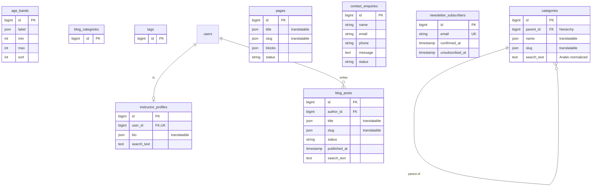
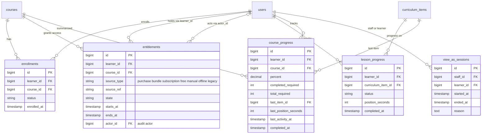

# Core ERD — P0–P4 entities (draft, T-P0-05)

- **Status:** draft for P1–P4 tasks. Ownership and names come from `docs/adr/ADR-002-modules.md`.
- Columns shown are only the keys and the fields the docs name (Arch §4/§10.1/§11.1, AI spec §16). Each owning task finalizes columns in its migration.
- Types are conceptual (`bigint`, `string`, `json`, …). Translatable fields are JSON (ED-006). Money is integer minor units + currency (Conventions §4).
- Later-phase tables (P5+) appear only as stubs in §5 so FK direction is visible.
- **Rendering:** five diagrams rendered by Mermaid CLI. Source hash and evidence: agents/logs/T-P0-05/verification.txt.

## 1. Identity, family, audit, settings (P0–P1; sessions P4)

```mermaid
erDiagram
    users {
        bigint id PK
        string email "nullable; uniqueness proposed"
        string phone "nullable E.164; uniqueness proposed"
        string username UK "child login (Arch 10.1)"
        string name_ar
        string name_en
        string display_name
        smallint birth_year
        tinyint birth_month
        string locale
        string timezone
        string status
        text two_factor_secret "encrypted (ED-016)"
        text two_factor_recovery_codes "encrypted"
        timestamp two_factor_confirmed_at
    }
    student_profiles {
        bigint id PK
        bigint user_id FK, UK
    }
    guardian_profiles {
        bigint id PK
        bigint user_id FK, UK
    }
    guardian_child_links {
        bigint id PK
        bigint guardian_id FK
        bigint child_id FK
        string status
        timestamp verified_at
        string consent_ref
    }
    guardian_link_codes {
        bigint id PK
        string code_hash UK
        bigint learner_id FK
        timestamp expires_at
        timestamp used_at
    }
    roles {
        bigint id PK
        string name
        string guard_name
    }
    permissions {
        bigint id PK
        string name
        string guard_name
    }
    model_has_roles {
        bigint role_id FK
        string model_type
        bigint model_id
    }
    role_has_permissions {
        bigint permission_id FK
        bigint role_id FK
    }
    consents {
        bigint id PK
        bigint user_id FK
        string type "terms privacy guardian cookies ai"
        string version
        timestamp granted_at
        timestamp withdrawn_at
    }
    activity_log {
        bigint id PK
        string log_name
        string event
        string subject_type
        bigint subject_id
        string causer_type
        bigint causer_id
        json properties
    }
    user_sessions {
        bigint id PK
        bigint user_id FK
        timestamp last_seen_at
        timestamp revoked_at
    }
    user_devices {
        bigint id PK
        bigint user_id FK
        string fingerprint_hash
        string user_agent
        string last_ip "hashed or truncated"
        timestamp last_seen_at
        timestamp revoked_at
    }
    account_sharing_flags {
        bigint id PK
        bigint user_id FK
        string signal
        string window
        string status
    }
    settings {
        bigint id PK
        string group
        string name
        json payload
    }
    features {
        bigint id PK
        string name
        string scope
        text value
    }
    flag_approvals {
        bigint id PK
        string flag
        string approval_ref
        bigint approved_by FK
        timestamp approved_at
    }

    users ||--o| student_profiles : "has"
    users ||--o| guardian_profiles : "has"
    users ||--o{ guardian_child_links : "guardian"
    users ||--o{ guardian_child_links : "child"
    users ||--o{ guardian_link_codes : "learner"
    roles ||--o{ model_has_roles : "assigned"
    roles ||--o{ role_has_permissions : "grants"
    permissions ||--o{ role_has_permissions : "in"
    users ||--o{ consents : "gives"
    users ||--o{ user_devices : "uses"
    users ||--o{ user_sessions : "opens"
    users ||--o{ account_sharing_flags : "flagged"
    users ||--o{ flag_approvals : "approves"
```

Notes: `model_has_roles`, `role_has_permissions`, `activity_log`, `settings`, `features` are package tables that implement Arch `user_roles`, `role_permissions`, `audit_logs`, `settings`, `feature_flags` (ADR-002 §3). `certificate_names` may become user columns (decided in T-P1-02).

## 2. Catalog and CMS (P2)

## 3. Courses, curriculum, media and lesson PDFs (P3)

```mermaid
erDiagram
    courses {
        bigint id PK
        bigint category_id FK
        string owner_type "academy or instructor"
        bigint owner_id
        json title "translatable"
        json slug "translatable"
        string status
        string format "recorded live hybrid"
        string access_mode
        string sequence_mode "free or sequential (ED-025)"
        int min_age "T-P1-07"
        int max_age "T-P1-07"
        text search_text
    }
    course_instructors {
        bigint id PK
        bigint course_id FK
        bigint instructor_id FK
        string role
    }
    course_revisions {
        bigint id PK
        bigint course_id FK
        bigint author_id FK
        json payload
        string status "draft pending approved rejected"
        bigint reviewer_id FK
        text reason
    }
    course_sections {
        bigint id PK
        bigint course_id FK
        json title "translatable"
        int sort
    }
    lessons {
        bigint id PK
        string type
        int duration_seconds
        boolean is_preview
    }
    curriculum_items {
        bigint id PK
        bigint course_id FK
        bigint section_id FK
        int sort "only ordering source (ED-002)"
        string itemable_type "lesson quiz assignment live_session"
        bigint itemable_id
        string status
        string visibility
        string unlock_rule "none absolute relative_days"
        timestamp unlock_at
        int unlock_days
        boolean required
    }
    media_assets {
        bigint id PK
        string provider
        string external_id
        string status
        string protection_tier "T1 T2 T3"
        string exception_reason
        bigint library_item_id FK
    }
    library_items {
        bigint id PK
        string owner_type "academy or instructor"
        bigint owner_id
        bigint media_asset_id FK
        string file_ref
        json title "translatable"
        json tags
    }
    subtitle_tracks {
        bigint id PK
        bigint media_asset_id FK
        string locale
        string file_ref
        string label
        boolean is_default
    }
    lesson_resources {
        bigint id PK
        bigint lesson_id FK
        bigint library_item_id FK
        string type
        string file_ref
        string download_rule
    }
    lesson_curriculum_documents {
        bigint id PK
        bigint lesson_id FK
        int version
        string file_ref
        string sha256
        int pages
        string status "UPLOADED to READY (AI spec 6)"
        string failure_reason
        decimal quality_score
        bigint approved_by FK
        timestamp approved_at
        boolean active
    }
    lesson_document_pages {
        bigint id PK
        bigint document_id FK
        int page_no
        longtext raw_text
        longtext approved_text
        boolean ocr_used
        decimal quality_score
    }
    lesson_key_terms {
        bigint id PK
        bigint document_id FK
        string term
        string locale
        boolean approved
    }
    lesson_document_chunks {
        bigint id PK
        bigint document_id FK
        int page_from
        int page_to
        longtext text
        blob embedding "chunked mode only (ED-011)"
    }
    ai_prompt_versions {
        bigint id PK
        string version UK
        longtext template
        boolean active
        bigint created_by FK
    }

    categories ||--o{ courses : "classifies"
    courses ||--o{ course_instructors : "assigns"
    users ||--o{ course_instructors : "teaches"
    courses ||--o{ course_revisions : "revised by"
    users ||--o{ course_revisions : "authors via author_id"
    users |o--o{ course_revisions : "reviews via reviewer_id"
    courses ||--o{ course_sections : "contains"
    courses ||--o{ curriculum_items : "orders"
    course_sections ||--o{ curriculum_items : "groups"
    lessons ||--o| curriculum_items : "placed as"
    library_items |o--o{ media_assets : "catalogs via library_item_id"
    media_assets |o--o{ library_items : "referenced via media_asset_id"
    media_assets ||--o{ subtitle_tracks : "captions"
    lessons ||--o{ lesson_resources : "attaches"
    library_items ||--o{ lesson_resources : "reused as"
    lessons ||--o{ lesson_curriculum_documents : "versions"
    users |o--o{ lesson_curriculum_documents : "approves via approved_by"
    users ||--o{ ai_prompt_versions : "creates via created_by"
    lesson_curriculum_documents ||--o{ lesson_document_pages : "pages"
    lesson_curriculum_documents ||--o{ lesson_key_terms : "terms"
    lesson_curriculum_documents ||--o{ lesson_document_chunks : "chunks"
    lesson_curriculum_documents ||--o{ ai_conversations : "P3 version"
    ai_conversations ||--o{ ai_messages : "P3"
    ai_messages ||--o{ ai_feedback : "P3"
    lesson_curriculum_documents ||--o{ ai_answer_cache : "P3"
    users ||--o{ ai_quota_counters : "P3"
    ai_conversations ||--o{ ai_safeguarding_flags : "P3"
    lessons ||--o{ ai_eval_cases : "P3"
    lessons ||--o{ ai_usage : "P3"
    lessons ||--o{ ai_eval_runs : "P3 evaluation"
```

AI hook: `lesson_curriculum_documents`, `lesson_document_pages`, `lesson_key_terms` (Media) and `lesson_document_chunks`, `ai_prompt_versions` (AI) are P3 tables from AI spec §16 (T-P3-08..10). `curriculum_items.itemable_*` also points to quizzes, assignments and live sessions (P5–P6, §5).

## 4. Access and progress (P4)

`view_as_sessions` is created in P9 (T-P9-10) per ADR-002; it is drawn here because it reads learner access state. Access is decided only by `EntitlementService::canAccessItem()` (Arch §11.2).

## 5. Later-phase stubs (P5–P10) — FK direction only

```mermaid
erDiagram
    courses ||--o{ cohorts : "P5"
    cohorts ||--o{ cohort_members : "P5"
    cohorts ||--o{ cohort_instructors : "P5"
    entitlements ||--o{ cohort_members : "P5 seat"
    cohorts ||--o{ live_sessions : "P5"
    live_sessions ||--o{ live_attendance : "P5"
    courses ||--o{ quizzes : "P6"
    quizzes ||--o{ questions : "P6"
    questions ||--o{ question_options : "P6"
    quizzes ||--o{ quiz_attempts : "P6"
    quiz_attempts ||--o{ quiz_answers : "P6"
    courses ||--o{ assignments : "P6"
    assignments ||--o{ assignment_submissions : "P6"
    assignment_submissions ||--o{ submission_feedback : "P6"
    certificate_templates ||--o{ certificates : "P6"
    courses ||--o{ certificates : "P6"
    ai_messages ||--o| help_requests : "P7 escalates"
    help_requests ||--o{ help_request_messages : "P7"
    help_requests ||--o{ help_request_events : "P7"
    users ||--o{ orders : "P8"
    orders ||--o{ order_items : "P8 sellable"
    orders ||--o{ payment_attempts : "P8"
    orders ||--o{ payments : "P8"
    payments ||--o{ refunds : "P8"
    orders ||--o{ manual_payment_proofs : "P8"
    orders ||--o{ e_receipts : "P8"
    coupons ||--o{ coupon_redemptions : "P8"
    orders ||--o{ coupon_redemptions : "P8"
    bundles ||--o{ bundle_items : "P8"
    courses ||--o{ bundle_items : "P8"
    subscription_plans ||--o{ subscription_plan_courses : "P8"
    subscription_plans ||--o{ subscriptions : "P8"
    subscriptions ||--o{ subscription_periods : "P8"
    subscriptions ||--o{ subscription_reminders : "P8"
    courses ||--o{ course_commission_rules : "P8"
    users ||--o{ instructor_ledger_entries : "P8 instructor"
    instructor_settlements ||--o{ settlement_items : "P8"
    instructor_ledger_entries ||--o| settlement_items : "P8"
    users ||--o{ instructor_applications : "P9"
    instructor_agreements ||--o{ instructor_agreement_acceptances : "P9"
    users ||--o| instructor_payout_profiles : "P9"
    users ||--o{ wishlists : "P9"
    courses ||--o{ course_reviews : "P9"
    users ||--o{ data_requests : "P9"
    users ||--o{ notifications : "P5"
    migration_batches ||--o{ migration_records : "P10"
    migration_batches ||--o{ migration_exceptions : "P10"
```

Standalone later tables (no FK worth drawing yet): `payment_webhook_events`, `payment_reconciliations` (P8), `email_logs` (P5), `announcements`, `retention_policies`, `integration_settings` (P9).

## 6. Unique constraints and idempotency keys

Mermaid cannot express composite keys, so they are listed here. **Documented** = the key is stated in the cited doc. **Proposed (T-P0-05)** = the doc requires idempotency/uniqueness but names no columns; the owning task confirms or changes it and records the change in ADR-002.

| Table | Unique key | Purpose | Status |
|---|---|---|---|
| `users` | `username` | child login | Documented (Arch §10.1) |
| `entitlements` | (`source_type`, `source_ref`, `learner_id`, `course_id`) | grant once per source (webhook, manual, subscription, migration) | Documented (Conventions §5; Arch §5.2, §7) |
| `course_progress` | (`learner_id`, `course_id`) | one summary per learner/course | Documented (Arch §11.1) |
| `lesson_progress` | (`learner_id`, `curriculum_item_id`) | one row per item | Documented (Arch §11.1 "keyed by") |
| `wishlists` | (`user_id`, `course_id`) | no duplicate wishlist | Documented (Arch §10.1) |
| `payment_webhook_events` | `event_id` | process each gateway event once | Documented (Arch §10.1, §10.2) |
| `manual_payment_proofs` | `transfer_reference` | one proof per transfer | Documented (Arch §10.1) |
| `subscription_reminders` | (`subscription_id`, `period`, `offset_days`) | one reminder per period + offset | Documented (Arch §10.1 "unique per period+offset"); column for period proposed |
| `help_requests` | `ai_message_id` | one escalation per AI message | Documented (AI spec §16) |
| `notification_dispatches` | `dedupe_key` | send each notification once | Documented (T-P5-04) |
| `settlement_items` | `instructor_ledger_entry_id` | prevent settling a ledger entry twice | Proposed (T-P0-05); owning task finalizes column name |
| `payments` | (`gateway`, `gateway_transaction_id`) | fulfil each payment once | Proposed (T-P0-05) for Arch §7 |
| `instructor_ledger_entries` | (`source_type`, `source_id`, `course_id`, `instructor_id`, `entry_type`) | ledger generated once per sale/period (incl. subscription period earnings) | Proposed (T-P0-05) for Arch §5.4, §7 |
| `certificates` | `verification_code`; (`learner_id`, `course_id`) | one certificate per learner/course; public verifier | Proposed (T-P0-05) for Arch §7 |
| `migration_records` | (`source_system`, `source_table`, `source_id`) | idempotent re-runs | Proposed (T-P0-05) for Arch §7, R-010 |
| `guardian_child_links` | (`guardian_id`, `child_id`) | one link per pair | Proposed (T-P0-05) |
| `guardian_link_codes` | `code_hash` | code lookup | Proposed (T-P0-05) |
| `curriculum_items` | (`itemable_type`, `itemable_id`) | an item is placed once | Proposed (T-P0-05) for ED-002 |
| `lesson_curriculum_documents` | (`lesson_id`, `version`) | versioning (AI spec §6.7) | Proposed (T-P0-05) |
| `lesson_document_pages` | (`document_id`, `page_no`) | one row per page | Proposed (T-P0-05) |
| `ai_answer_cache` | (`document_version`, `question_hash`, `locale`, `style_tier`) | cache key (AI spec §10.3 fields) | Proposed (T-P0-05) |
| `ai_quota_counters` | (`student_id`, `scope`, `period`) | one counter per window | Proposed (T-P0-05) |
| `course_instructors` | (`course_id`, `instructor_id`) | no duplicate assignment | Proposed (T-P0-05) |
| `cohort_members` | (`cohort_id`, `learner_id`) | one seat per learner | Proposed (T-P0-05) |
| `coupon_redemptions` | (`coupon_id`, `order_id`) | redeem once per order | Proposed (T-P0-05) |
| `student_profiles`, `guardian_profiles`, `instructor_profiles` | `user_id` | one profile per user | Proposed (T-P0-05) |
| `newsletter_subscribers` | `email` | one subscription per address | Proposed (T-P0-05) |
| `ai_prompt_versions` | `version` | immutable prompt versions | Proposed (T-P0-05) |

Foreign keys: relationship lines identify targets for the fields marked FK in §1–§4; optional approval/review/actor references remain nullable until their owning task defines requiredness. The two media/library references are distinct nullable associations, not a requirement to populate a cycle. Polymorphic columns (`owner_type/owner_id`, `itemable_type/itemable_id`, `sellable_type/sellable_id`, `source_type/source_ref`, audit `subject_type/subject_id` and `causer_type/causer_id`, spatie `model_type/model_id`) have no DB-level FK; integrity is enforced in the owning Action.

AI foundation tables shown in §3 are created by T-P3-10 (AI spec §16); P7 implements behavior. Document versions are logical references, not globally unique foreign keys; owning migrations must scope by lesson. Blog category/tag relationships remain to be finalized by T-P2-07. Age bands are P1 despite their catalog grouping.
